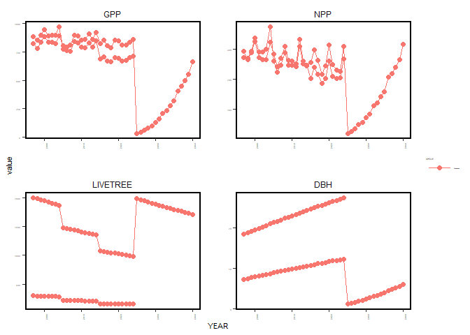
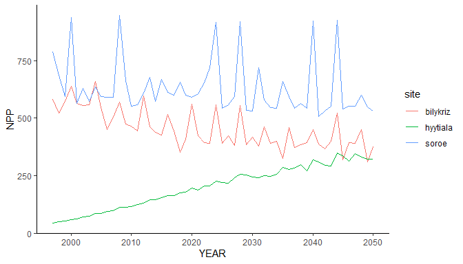
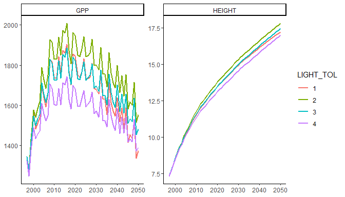

# Getting started with R3DFEM

R3DFEM is an R interface to the version 5.7 of the
[3D-CMCC-FEM](https://www.forest-modelling-lab.com/the-3d-cmcc-model), a
bio-geochemical, process-based forest model that simulates carbon, water
and nitrogen fluxes and stocks of homogeneous and heterogeneous forests.
This vignette shows the whole workflow: install the model, prepare the
inputs, run one or many simulations, read and plot the outputs. The
creation of the input files is described in detail in
[`vignette("input-files")`](https://vangielia.github.io/R3DFEM/articles/input-files.md).

``` r

library(R3DFEM)
```

## Installing the model

The package does not contain the model executable.
[`install_model()`](https://vangielia.github.io/R3DFEM/reference/install_model.md)
downloads the Windows build of the version 5.7 once, in a user
directory; an executable already on disk can be installed with
`install_model("path/to/3D_CMCC_Forest_Model_5.7.exe")` or used directly
with `options(R3DFEM.exe = "path/to/executable")` (e.g. a binary
compiled on Linux from the [source
code](https://github.com/Forest-Modelling-Lab/3D-CMCC-FEM)).

``` r

install_model()
```

``` r

model_available()
#> [1] TRUE
```

## Inputs

A simulation needs a directory with the stand, meteo, CO2, soil and
topography files of the site and the parameterization of the species.
The package contains complete input sets for three sites and the
parameterizations of the version 5.7 for 19 species:

``` r

bk <- system.file("extdata", "bilykriz", "rcp0p0", package = "R3DFEM")
list.files(bk)
#> [1] "BilyKriz_co2.txt"   "BilyKriz_meteo.txt" "BilyKriz_soil.txt" 
#> [4] "BilyKriz_stand.txt" "BilyKriz_topo.txt"  "Piceaabies.txt"
list_species()
#>  [1] "Abiesalba"              "Betulapubescens"        "Castaneasativa"        
#>  [4] "Castaneasativa_coppice" "Fagussylvatica"         "Fagussylvatica_coppice"
#>  [7] "Larixdecidua"           "Piceaabies"             "Pinushalepensis"       
#> [10] "Pinuslaricio"           "Pinuspinaster"          "Pinuspinea"            
#> [13] "Pinussylvestris"        "Quercuscerris"          "Quercuscerris_coppice" 
#> [16] "Quercusilex"            "Quercusilex_coppice"    "Quercuspubescens"      
#> [19] "Quercusrobur"
```

[`setup_inputs()`](https://vangielia.github.io/R3DFEM/reference/setup_inputs.md)
prepares an input directory in one call, from files, values or arguments
of the `make_*()` helpers, and copies the species files. Here we start a
new site from the Bily Kriz weather, with a stand of two cohorts of
Norway spruce:

``` r

inputdir <- file.path(tempdir(), "spruce")
files <- setup_inputs("Spruce", inputdir,
                      stand = list(year = 1997, age = c(16, 30), species = "Piceaabies",
                                   n_trees = c(2000, 300), avdbh = c(7.1, 18), height = c(5.6, 14)),
                      soil = list(lat = 49.3, lon = 18.32, clay = 20.6, silt = 20.6,
                                  sand = 58.8, soil_depth = 80),
                      topo = 875,
                      meteo = file.path(bk, "BilyKriz_meteo.txt"),
                      co2 = file.path(bk, "BilyKriz_co2.txt"),
                      management = list(thinning = c(2005, 2015), thinning_int = c(20, 20),
                                        harvesting = 2025))
basename(files)
#> [1] "Spruce_stand.txt"      "Spruce_soil.txt"       "Spruce_topo.txt"      
#> [4] "Spruce_meteo.txt"      "Spruce_co2.txt"        "Spruce_management.txt"
#> [7] "Piceaabies.txt"
```

[`check_inputs()`](https://vangielia.github.io/R3DFEM/reference/check_inputs.md)
performs the checks of
[`run_3DCMCCFEM()`](https://vangielia.github.io/R3DFEM/reference/run_3DCMCCFEM.md)
without running the model, for example the harvest of 2025 requires the
replanting arguments:

``` r

check_inputs("Spruce", "Piceaabies", year_start = 1997, year_end = 2040,
             man = "var", pres_dens = "off", inputdir = inputdir)
#> Error in .check_run_inputs(site = site, species = species, year_start = year_start, : 
#> 'man' = var and harvesting year ('Harvesting') is reached: 
#> * Replanting arguments are missing, with no default.
```

## Running the model

[`run_3DCMCCFEM()`](https://vangielia.github.io/R3DFEM/reference/run_3DCMCCFEM.md)
writes the settings file in `inputdir`, runs the model and returns the
paths of the outputs, named by type. The model cannot write files whose
full path is longer than 260 characters: use short output directories.

``` r

out <- "C:/r3dfem_vignette"

off <- run_3DCMCCFEM(site = "Spruce", species = "Piceaabies",
                     year_start = 1997, year_end = 2040, man = "off",
                     output = "annual", inputdir = inputdir,
                     outputdir = file.path(out, "off"))

var <- run_3DCMCCFEM(site = "Spruce", species = "Piceaabies",
                     year_start = 1997, year_end = 2040,
                     man = "var", pres_dens = "off",
                     rep_species = "Piceaabies", rep_trees = 2000, rep_age = 3,
                     rep_dbh = 1, rep_lai = 1, rep_height = 1.3,
                     output = "annual", inputdir = inputdir,
                     outputdir = file.path(out, "var"))
basename(var)
#> [1] "annual_Spruce_co2_on_man_var_pres_dens_off_reg_off_1997-2040.txt"    
#> [2] "annual_man_Spruce_co2_on_man_var_pres_dens_off_reg_off_1997-2040.txt"
```

[`read_output()`](https://vangielia.github.io/R3DFEM/reference/read_output.md)
reads an output as a data.frame (one row per year, layer and class):

``` r

a <- read_output(var[["annual"]])
a[a$YEAR %in% c(2004:2006, 2024:2026), c("YEAR", "LAYER", "AGE", "LIVETREE", "DBH", "HEIGHT", "NPP")]
#>    YEAR LAYER AGE LIVETREE      DBH   HEIGHT      NPP
#> 15 2004     1  37      285 21.00430 20.71210 374.1735
#> 16 2004     0  23     1867  8.71908  8.64211 323.5464
#> 17 2005     1  38      226 21.35320 20.98060 260.7584
#> 18 2005     0  24     1480  8.93949  8.88881 283.8713
#> 19 2006     1  39      224 21.66810 21.21920 224.4143
#> 20 2006     0  25     1466  9.12064  9.09159 241.5253
#> 55 2024     1  57      156 27.51520 25.02790 266.6800
#> 56 2024     0  43      987 12.37940 12.68120 309.6152
#> 57 2025     0   4     1980  1.21380  1.62773  19.4864
#> 58 2026     0   5     1961  1.42490  1.73109  27.0734
```

## Plotting

[`plot_output_3DFEM()`](https://vangielia.github.io/R3DFEM/reference/plot_output_3DFEM.md)
plots one or more variables (optionally with a rolling mean) or a
variable against another:

``` r

plot_output_3DFEM(var[["annual"]], y = c("GPP", "NPP", "LIVETREE", "DBH"), text_size = 14)
#> Warning in melt.data.table(df, id.vars = c(x.axis, id.var)): 'measure.vars'
#> [GPP, NPP, LIVETREE, DBH, ...] are not all of the same type. By order of
#> hierarchy, the molten data value column will be of type 'double'. All measure
#> variables not of type 'double' will be coerced too. Check DETAILS in
#> ?melt.data.table for more on coercion.
```



plot of chunk plot-output

## Many simulations

[`run_batch()`](https://vangielia.github.io/R3DFEM/reference/run_batch.md)
runs a set of simulations, one per row of a data.frame, each in its own
directory with a copy of the inputs. The columns are arguments of
[`run_3DCMCCFEM()`](https://vangielia.github.io/R3DFEM/reference/run_3DCMCCFEM.md)
(or parameters of the species file, see below); `inputdir` can change
from run to run. With `parallel = TRUE` the simulations are run with the
future plan set by the user:

``` r

sites <- system.file("extdata", c("bilykriz/rcp0p0", "hyytiala", "soro"), package = "R3DFEM")
runs <- data.frame(id = c("bilykriz", "hyytiala", "soroe"),
                   site = c("BilyKriz", "Hyytiala", "Soroe"),
                   species = c("Piceaabies", "Pinussylvestris", "Fagussylvatica"),
                   inputdir = sites)

future::plan("multisession", workers = 3)
res <- run_batch(runs, outputdir = file.path(out, "sites"), year_start = 1997,
                 year_end = 2050, man = "off", output = "annual", parallel = TRUE)
future::plan("sequential")
res[, c("id", "status")]
#>         id status
#> 1 bilykriz     ok
#> 2 hyytiala     ok
#> 3    soroe     ok
```

The outputs of all the runs can be read together:

``` r

all <- read_output(res$output)
all$site <- basename(dirname(dirname(all$file)))
ggplot2::ggplot(all, ggplot2::aes(YEAR, NPP, colour = site)) +
  ggplot2::geom_line() +
  ggplot2::theme_classic()
```



plot of chunk batch-plot

Columns named as species parameters change the parameterization of each
run.
[`param_sensitivity()`](https://vangielia.github.io/R3DFEM/reference/param_sensitivity.md)
uses this to show the effect of a parameter:

``` r

s <- param_sensitivity("LIGHT_TOL", value = 1:4, variable = c("GPP", "HEIGHT"),
                       inputdir = bk, outputdir = file.path(out, "sens"),
                       site = "BilyKriz", species = "Piceaabies",
                       year_start = 1997, year_end = 2050, man = "off")
s$plot
```



plot of chunk sensitivity

## Virtual stands

[`virtual_stand_generator()`](https://vangielia.github.io/R3DFEM/reference/virtual_stand_generator.md)
simulates the stand development and writes stand files for age classes
that are not observed, to be used as starting points of new simulations:

``` r

vdir <- file.path(tempdir(), "bk")
dir.create(vdir)
invisible(file.copy(list.files(bk, full.names = TRUE), vdir))
vs <- virtual_stand_generator(site = "BilyKriz", species = "Piceaabies", stand_age = c(40, 60),
                              man = "off", inputdir = vdir, outputdir = file.path(out, "virtual"))
vs[, c("Age", "Species", "N", "AvDBH", "Height")]
#>   Age    Species    N   AvDBH  Height
#> 1  40 Piceaabies 1884 12.9227 13.2593
#> 2  60 Piceaabies 1533 15.5468 15.9295
```

## References

R3DFEM: an R package for running the 3D-CMCC-FEM model. *Earth Science
Informatics* (2025).
<https://link.springer.com/article/10.1007/s12145-025-01956-0>

The model User Guide, with the full description of inputs and outputs,
is available on the [Forest Modelling Lab web
page](https://www.forest-modelling-lab.com/the-3d-cmcc-model).
