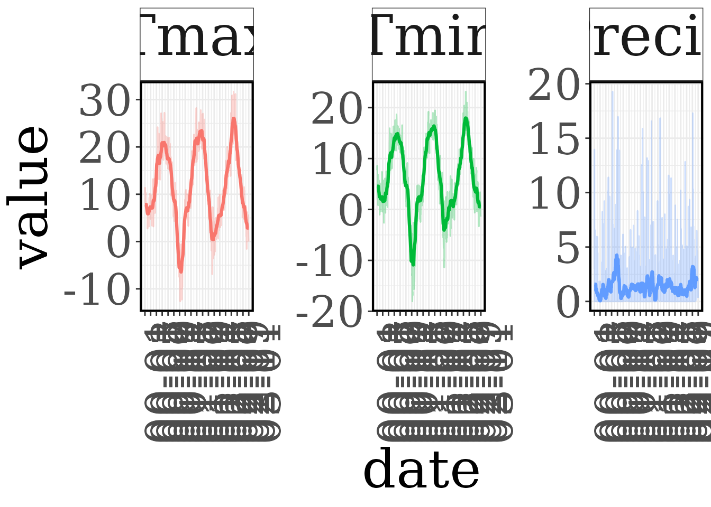
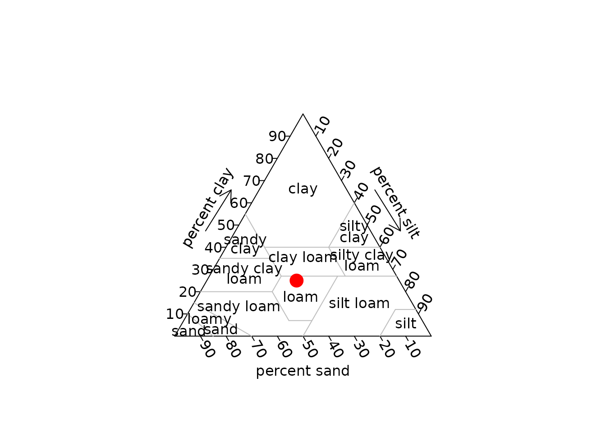

# Input files and species parameters

``` r

library(R3DFEM)
```

The 3D-CMCC-FEM needs a set of .txt files, all in the same directory and
named after the site (`Site`) or the species. This vignette describes
them and the helpers that create them. All the helpers write the file in
`outdir` and return the data invisibly;
[`setup_inputs()`](https://vangielia.github.io/R3DFEM/reference/setup_inputs.md)
calls them in one go (see
[`vignette("R3DFEM")`](https://vangielia.github.io/R3DFEM/articles/R3DFEM.md)).

| File | Content | Helpers |
|----|----|----|
| `Site_stand.txt` | initial stand: species, age, number of trees, DBH, height per class | [`make_stand()`](https://vangielia.github.io/R3DFEM/reference/make_stand.md), [`virtual_stand_generator()`](https://vangielia.github.io/R3DFEM/reference/virtual_stand_generator.md) |
| `Site_meteo.txt` | daily weather | [`make_meteo()`](https://vangielia.github.io/R3DFEM/reference/make_meteo.md), [`make_meteo_EOBS()`](https://vangielia.github.io/R3DFEM/reference/make_meteo_EOBS.md), [`make_CCS()`](https://vangielia.github.io/R3DFEM/reference/make_CCS.md), [`check_meteo_3DFEM()`](https://vangielia.github.io/R3DFEM/reference/check_meteo_3DFEM.md) |
| `Site_co2.txt` | yearly atmospheric CO2 concentration | [`make_co2()`](https://vangielia.github.io/R3DFEM/reference/make_co2.md), [`make_CCS()`](https://vangielia.github.io/R3DFEM/reference/make_CCS.md) |
| `Site_soil.txt` | soil texture and depth | [`make_soil()`](https://vangielia.github.io/R3DFEM/reference/make_soil.md), [`make_soil_ISRIC()`](https://vangielia.github.io/R3DFEM/reference/make_soil_ISRIC.md) |
| `Site_topo.txt` | elevation | [`make_topo()`](https://vangielia.github.io/R3DFEM/reference/make_topo.md) |
| `Site_management.txt` | management events (only with `man = "var"`) | [`make_management()`](https://vangielia.github.io/R3DFEM/reference/make_management.md) |
| `Species.txt` | species parameterization (version 5.7) | [`list_species()`](https://vangielia.github.io/R3DFEM/reference/list_species.md), [`copy_species()`](https://vangielia.github.io/R3DFEM/reference/list_species.md), [`read_species()`](https://vangielia.github.io/R3DFEM/reference/read_species.md), [`set_species_param()`](https://vangielia.github.io/R3DFEM/reference/read_species.md) |

``` r

inputdir <- file.path(tempdir(), "Collelongo")
```

## Stand

One row per class (species, age, DBH, height) and year. With
`man = "var"` and `pres_dens = "on"` the rows of the following years
prescribe the stand density.

``` r

make_stand("Collelongo", year = 2000, age = c(90, 120), species = "Fagussylvatica",
           n_trees = c(600, 150), avdbh = c(28, 45), height = c(22, 27), outdir = inputdir)
#> Outdir does not exist. It will be created
#> file /tmp/Rtmp6RTMCO/Collelongo/Collelongo_stand.txt saved
```

## Meteo

Daily data with the columns Year, Month, n_days, Rg_f (MJ m⁻² day⁻¹),
Ta_f, Tmax, Tmin (°C), RH_f (%), Ts_f, Precip (mm day⁻¹), SWC, LAI, ET
and WS_f (-9999 when not available).
[`make_meteo()`](https://vangielia.github.io/R3DFEM/reference/make_meteo.md)
converts any daily data.frame (e.g. a weather station): it computes the
mean temperature if missing, converts the radiation from W m⁻²
(`rad_unit = "W"`) and checks the result with
[`check_meteo_3DFEM()`](https://vangielia.github.io/R3DFEM/reference/check_meteo_3DFEM.md).

``` r

soro <- read.delim(system.file("extdata", "soro", "Soroe_meteo.txt", package = "R3DFEM"))
station <- data.frame(date = as.Date(sprintf("%d-%02d-%02d", soro$Year, soro$Month, soro$n_days)),
                      Rg_f = soro$Rg_f / 0.0864, Tmax = soro$Tmax, Tmin = soro$Tmin,
                      Precip = soro$Precip, RH_f = soro$RH_f)
station <- subset(station, date < as.Date("2031-01-01"))
head(station, 3)
#>         date      Rg_f    Tmax    Tmin Precip   RH_f
#> 1 1997-01-01  6.293981  7.4441 1.89820 0.0000 94.295
#> 2 1997-01-02  3.076042  9.4783 5.94700 3.2897 92.315
#> 3 1997-01-03 19.307870 10.1170 0.28823 0.0000 84.790
meteo <- make_meteo(station, "Collelongo", rad_unit = "W", outdir = inputdir)
#> Warning in check_meteo_3DFEM(meteo, correct = FALSE, impute = FALSE, save =
#> FALSE): Relative humidity is greater than 100 for row(s): 384 414 715 1446 1447
#> 1448 1449 1450 1451 1452 1453 1455 1456 1457 1458 1459 1460 1461 1462 1465 1466
#> 1471 1472 1798 1805 1806 1816 1817 1818 1831 1832 1833 2169 2170 2913 2918 2941
#> 3268 3269 3270 3306 3633 3634 3635 3671 3998 3999 4000 4368 4369 4370 4371 4372
#> 4373 4374 4375 4377 4378 4379 4380 4381 4382 4383 4402 4432 4733 4749 4752 4753
#> 4758 4759 5085 5092 5093 5103 5104 5105 5835 5840 5863 5893 6194 6593 6623 6924
#> 7296 7301 7310 7311 7312 7648 7649 7689 7719 8020 8040 8041 8042 8378 8379 8757
#> 8762 8771 8772 8773 9109 9110 9150 9180 9481 10212 10213 10214 10215 10216
#> 10217 10218 10219 10221 10222 10223 10224 10225 10226 10227 10962 10963 10964
#> 11300 11301 11673 11674 11675 11676 11677 11678 11679 11680 11682 11683 11684
#> 11685 11686 11687 11688
#> Warning in check_meteo_3DFEM(meteo, correct = FALSE, impute = FALSE, save =
#> FALSE): There are 40 row(s) in which precipitation is less than the precision
#> of the model!
#> file /tmp/Rtmp6RTMCO/Collelongo/Collelongo_meteo.txt saved
```

``` r

plot_meteo_3DFEM(file.path(inputdir, "Collelongo_meteo.txt"), var = c("Tmax", "Tmin", "Precip"),
                 daterange = c("2000-01-01", "2002-12-31"), window = 30)
```



For European sites the weather can be extracted from
[E-OBS](https://surfobs.climate.copernicus.eu/dataaccess/access_eobs.php)
(version 30.0 or 29.0). The netCDF files (ensemble mean, 0.1 degrees,
variables hu, qq, rr, tg, tn, tx) are not distributed with the package:
download them and set their directory once.

``` r

options(R3DFEM.eobs_dir = "D:/EOBS")
make_meteo_EOBS(data.frame(x = 13.59, y = 41.85), crs = 4326, site = "Collelongo",
                daterange = c("2000-01-01", "2023-12-31"), outdir = inputdir)
```

[`make_CCS()`](https://vangielia.github.io/R3DFEM/reference/make_CCS.md)
builds a detrended “current climate scenario” by resampling the observed
years (leap years with leap years), e.g. to run the model beyond the
observations:

``` r

make_CCS(meteo = file.path(inputdir, "Collelongo_meteo.txt"), obs_year = c(2000, 2020),
         end_year = 2100, outdir = file.path(tempdir(), "ccs"))
#> Outdir does not exist. It will be created
#> /tmp/Rtmp6RTMCO/ccs/Collelongo_meteo.txt saved!
```

## CO2

Yearly concentration (ppm).
[`make_co2()`](https://vangielia.github.io/R3DFEM/reference/make_co2.md)
accepts a constant, one value per year or known values interpolated
linearly over the years:

``` r

co2 <- make_co2("Collelongo", years = 2000:2100,
                co2 = data.frame(year = c(2000, 2020, 2100), CO2_ppm = c(369, 412, 600)),
                outdir = inputdir)
#> file /tmp/Rtmp6RTMCO/Collelongo/Collelongo_co2.txt saved
co2[c(1, 21, 101), ]
#>     year CO2_ppm
#> 1   2000     369
#> 21  2020     412
#> 101 2100     600
```

## Soil and topography

``` r

make_soil("Collelongo", lat = 41.85, lon = 13.59, clay = 25, silt = 35, sand = 40,
          soil_depth = 100, outdir = inputdir)
#> file /tmp/Rtmp6RTMCO/Collelongo/Collelongo_soil.txt saved
make_topo("Collelongo", elev = 1560, outdir = inputdir)
#> file /tmp/Rtmp6RTMCO/Collelongo/Collelongo_topo.txt saved
```

``` r

plot_soil_3DFEM(file.path(inputdir, "Collelongo_soil.txt"), pch = 21, bg.symbols = "red", cex = 2)
```



The texture of European sites can be taken from SoilGrids (raster not
distributed with the package):

``` r

options(R3DFEM.isric_file = "D:/SoilGrids/ISRIC.tif")
make_soil_ISRIC(data.frame(x = 13.59, y = 41.85), crs = 4326, site = "Collelongo",
                outdir = inputdir)
```

## Management

Used with `man = "var"`: years of thinning (and their intensity, % of
basal area), harvesting and regeneration.

``` r

make_management("Collelongo", thinning = c(2010, 2030), thinning_int = c(25, 20),
                harvesting = 2060, outdir = inputdir)
#> file /tmp/Rtmp6RTMCO/Collelongo/Collelongo_management.txt saved
readLines(file.path(inputdir, "Collelongo_management.txt"))
#> [1] "Thinning,2010,2030" "Thinning_int,25,20" "Harvesting,2060"
```

With `man = "on"` the model manages the stand with the parameters
ROTATION, THINNING and THINNING_INTENSITY of the species file instead.

## Species parameters

The package contains the parameterizations of the version 5.7 of the
model. Coppice stands have their own files
(e.g. `Fagussylvatica_coppice`).

``` r

list_species()
#>  [1] "Abiesalba"              "Betulapubescens"        "Castaneasativa_coppice"
#>  [4] "Castaneasativa"         "Fagussylvatica_coppice" "Fagussylvatica"        
#>  [7] "Larixdecidua"           "Piceaabies"             "Pinushalepensis"       
#> [10] "Pinuslaricio"           "Pinuspinaster"          "Pinuspinea"            
#> [13] "Pinussylvestris"        "Quercuscerris_coppice"  "Quercuscerris"         
#> [16] "Quercusilex_coppice"    "Quercusilex"            "Quercuspubescens"      
#> [19] "Quercusrobur"
copy_species("Fagussylvatica", inputdir)
sp <- read_species(file.path(inputdir, "Fagussylvatica.txt"))
nrow(sp)
#> [1] 94
head(sp)
#>     parameter value
#> 1   LIGHT_TOL 1.000
#> 2   PHENOLOGY 0.100
#> 3       ALPHA 0.057
#> 4 EPSILONgCMJ 0.690
#> 5 GAMMA_LIGHT 0.000
#> 6           K 0.710
```

[`set_species_param()`](https://vangielia.github.io/R3DFEM/reference/read_species.md)
changes one or more parameters, keeping the comments and the order of
the file, and returns the previous values (with `outfile` it writes a
new file, e.g. a site-specific parameterization):

``` r

set_species_param(file.path(inputdir, "Fagussylvatica.txt"), LIGHT_TOL = 2, ROTATION = 140)
```

The version 5.7 needs all the parameters of these files, including
`CONV_VOL_FACTOR` (conversion of stem biomass to volume). Files of older
versions are refused by
[`check_inputs()`](https://vangielia.github.io/R3DFEM/reference/check_inputs.md)
and
[`run_3DCMCCFEM()`](https://vangielia.github.io/R3DFEM/reference/run_3DCMCCFEM.md):

``` r

old <- file.path(tempdir(), "old")
dir.create(old)
file.copy(list.files(inputdir, full.names = TRUE), old)
#> [1] TRUE TRUE TRUE TRUE TRUE TRUE TRUE
sp_lines <- readLines(file.path(old, "Fagussylvatica.txt"))
writeLines(sp_lines[!grepl("^CONV_VOL_FACTOR", sp_lines)], file.path(old, "Fagussylvatica.txt"))
check_inputs("Collelongo", "Fagussylvatica", 2000, 2030, man = "off", inputdir = old)
#> Error in `.check_run_inputs()`:
#> ! 
#> Parameter(s) CONV_VOL_FACTOR missing in 'Fagussylvatica.txt' (required by the version 5.7 of the model, see list_species()).
```

## Checking the inputs

``` r

check_inputs("Collelongo", "Fagussylvatica", year_start = 2000, year_end = 2030,
             man = "var", pres_dens = "off", inputdir = inputdir,
             rep_species = "Fagussylvatica", rep_trees = 3000, rep_age = 3, rep_dbh = 1,
             rep_lai = 1, rep_height = 1.3)
#> All checks passed
list.files(inputdir)
#> [1] "Collelongo_co2.txt"        "Collelongo_management.txt"
#> [3] "Collelongo_meteo.txt"      "Collelongo_soil.txt"      
#> [5] "Collelongo_stand.txt"      "Collelongo_topo.txt"      
#> [7] "Fagussylvatica.txt"
```

For all details on the input files see the model [User
Guide](http://eprints.bice.rm.cnr.it/22393/1/3D-CMCC-FEM_User_Guide_v.2_July_2023.pdf).
