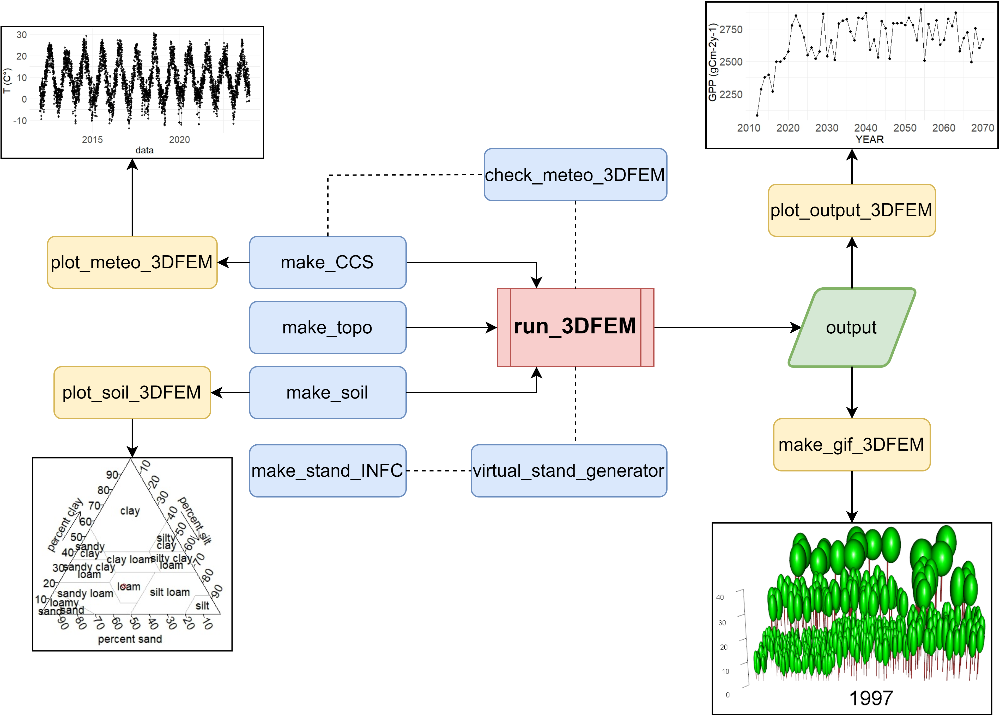

\# R3DFEM: An R package for running the 3D-CMCC-FEM model

R3DFEM runs the version **5.7** of the
[3D-CMCC-FEM](https://www.forest-modelling-lab.com/the-3d-cmcc-model)
forest model from R. It installs the model, prepares and checks the
input files, ships the species parameterizations of the version 5.7,
runs single simulations or batches of simulations (also in parallel) and
reads and plots the outputs. See the [official web
page](https://www.forest-modelling-lab.com/the-3d-cmcc-model) for the
complete model documentation.

## Installation

``` r

# install.packages("remotes")
remotes::install_github("VangiElia/R3DFEM", build_vignettes = TRUE)
library(R3DFEM)

# download the model executable (Windows build of the version 5.7), only once
install_model()
```

The executable is installed in a user directory
(`tools::R_user_dir("R3DFEM", "data")`). To use an executable already on
disk, e.g. a binary compiled on Linux or macOS from the [source
code](https://github.com/Forest-Modelling-Lab/3D-CMCC-FEM), use
`install_model("path/to/executable")` or
`options(R3DFEM.exe = "path/to/executable")`.

## Getting started

``` r

inp <- system.file("extdata", "bilykriz", "rcp0p0", package = "R3DFEM")
work <- file.path(tempdir(), "bilykriz")
setup_inputs("BilyKriz", work,
             stand = file.path(inp, "BilyKriz_stand.txt"), soil = file.path(inp, "BilyKriz_soil.txt"),
             topo = file.path(inp, "BilyKriz_topo.txt"), meteo = file.path(inp, "BilyKriz_meteo.txt"),
             co2 = file.path(inp, "BilyKriz_co2.txt"))
out <- run_3DCMCCFEM(site = "BilyKriz", species = "Piceaabies", year_start = 1997, year_end = 2050,
                     man = "off", output = "annual", inputdir = work, outputdir = "C:/sim/output")
head(read_output(out[["annual"]]))
plot_output_3DFEM(out[["annual"]], y = c("GPP", "NPP", "DBH"))
```

The vignettes describe the whole workflow and the input files:

``` r

vignette("R3DFEM")       # getting started: inputs, runs, batches, plots
vignette("input-files")  # input files and species parameters
```

## Functions

| Task | Functions |
|----|----|
| Install the model | [`install_model()`](https://vangielia.github.io/R3DFEM/reference/install_model.md), [`model_path()`](https://vangielia.github.io/R3DFEM/reference/install_model.md), [`model_available()`](https://vangielia.github.io/R3DFEM/reference/install_model.md) |
| Prepare the inputs | [`setup_inputs()`](https://vangielia.github.io/R3DFEM/reference/setup_inputs.md), [`make_stand()`](https://vangielia.github.io/R3DFEM/reference/make_stand.md), [`make_meteo()`](https://vangielia.github.io/R3DFEM/reference/make_meteo.md), [`make_co2()`](https://vangielia.github.io/R3DFEM/reference/make_co2.md), [`make_soil()`](https://vangielia.github.io/R3DFEM/reference/make_soil.md), [`make_topo()`](https://vangielia.github.io/R3DFEM/reference/make_topo.md), [`make_management()`](https://vangielia.github.io/R3DFEM/reference/make_management.md) |
| Inputs from European datasets | [`make_meteo_EOBS()`](https://vangielia.github.io/R3DFEM/reference/make_meteo_EOBS.md) (E-OBS 30.0 and 29.0), [`make_soil_ISRIC()`](https://vangielia.github.io/R3DFEM/reference/make_soil_ISRIC.md) (SoilGrids) |
| Species parameters (v. 5.7) | [`list_species()`](https://vangielia.github.io/R3DFEM/reference/list_species.md), [`species_file()`](https://vangielia.github.io/R3DFEM/reference/list_species.md), [`copy_species()`](https://vangielia.github.io/R3DFEM/reference/list_species.md), [`read_species()`](https://vangielia.github.io/R3DFEM/reference/read_species.md), [`set_species_param()`](https://vangielia.github.io/R3DFEM/reference/read_species.md) |
| Check the inputs | [`check_inputs()`](https://vangielia.github.io/R3DFEM/reference/check_inputs.md), [`check_meteo_3DFEM()`](https://vangielia.github.io/R3DFEM/reference/check_meteo_3DFEM.md) |
| Climate scenarios and virtual stands | [`make_CCS()`](https://vangielia.github.io/R3DFEM/reference/make_CCS.md), [`virtual_stand_generator()`](https://vangielia.github.io/R3DFEM/reference/virtual_stand_generator.md) |
| Run the model | [`run_3DCMCCFEM()`](https://vangielia.github.io/R3DFEM/reference/run_3DCMCCFEM.md), [`run_batch()`](https://vangielia.github.io/R3DFEM/reference/run_batch.md), [`param_sensitivity()`](https://vangielia.github.io/R3DFEM/reference/param_sensitivity.md) |
| Outputs | [`read_output()`](https://vangielia.github.io/R3DFEM/reference/read_output.md), [`plot_output_3DFEM()`](https://vangielia.github.io/R3DFEM/reference/plot_output_3DFEM.md), [`plot_meteo_3DFEM()`](https://vangielia.github.io/R3DFEM/reference/plot_meteo_3DFEM.md), [`plot_soil_3DFEM()`](https://vangielia.github.io/R3DFEM/reference/plot_soil_3DFEM.md) |

The E-OBS netCDF files and the SoilGrids raster are not distributed with
the package: download them and set `options(R3DFEM.eobs_dir = ...)` and
`options(R3DFEM.isric_file = ...)`.

The model cannot write files whose full path is longer than 260
characters: use short output directories.

## Workflow

Below is a schematic representation of the workflow of the package:



## I/O

Below, we present a schematic description of the input needed by the
functions in the R package: For initialization, the 3D-CMCC-FEM requires
as input data:

1.  The initial stand conditions: species name (since the model is
    parameterized at species level), age, mean tree height, diameter at
    breast height (DBH), and number of trees per size cell. The initial
    data are aggregated per classes (height classes, cohorts, and
    species) by a pre-processing activity as follows: (1) the relative
    values of diameters class is associated for each species, (2) the
    corresponding value of height class is assigned for each diameter
    class, and (3) the relative age is assigned for each height class
    (Collalti et al., 2014; 2024).
2.  Species-specific parameters are primarily based on species-specific
    eco-physiological and allometric characteristics and can be
    partially derived from forest inventories and literature (Collalti
    et al., 2019). The package comes with the parameterizations of the
    version 5.7 for the most common European tree species
    ([`list_species()`](https://vangielia.github.io/R3DFEM/reference/list_species.md)),
    used in many real case studies across Europe.
3.  Meteorological forcing data: daily maximum (Tmax, °C) and minimum
    air temperature (Tmin, °C), soil temperature (Tsoil, °C), vapor
    pressure deficit (hPa), global solar radiation (MJ m−2 day−1) and
    precipitation amount (mm day−1).
4.  Annual atmospheric CO2 concentration and nitrogen deposition
    (optional)(Collalti et al., 2018).
5.  Soil and topographic information: soil depth, average sand, clay,
    silt percentages, and elevation.

All input data need to be written into separate .txt files whose
structure is fully described in the [**user
manual**](https://www.forest-modelling-lab.com/_files/ugd/8a7700_d31451e9a5e64073b50c07f7f007eb71.pdf).
Based on the input files and the argument set, the function wrapping the
model (run_3DCMCCFEM) creates a setting file in the input directory used
only by the internal C code; the user does not need to interact with the
setting file.

The main output variables of the 3D-CMCC-FEM (either a daily, monthly,
or annual scale) are Gross Primary Productivity (GPP), Net Primary
Productivity (NPP), and state variables such as evapotranspiration (ET),
Leaf Area Index (LAI), and rain interception (to cite some). Results are
obtained either at class level (species, diameter, height, or age class
level), layer level (as the sum of all tree height classes in the same
layer), and grid level (as the sum of all classes in the different
layers). The model provides information to support decision-making in
forest management planning, such as mean annual volume increment (MAI),
current volume increment (CAI), basal area, and DBH.

For detailed information about 3D-CMCC-FEM and its applications, we
strongly encourage you to refer to the literature (Collalti et al.,
2014, 2016, 2020, 2024; Marconi et al., 2017; Mahnken et al., 2022;
Dalmonech et al., 2022, 2024; Testolin et al., 2023; Vangi et al.,
2024a, 2024b; Morichetti et al., 2024), and the main [**web
page**](https://www.forest-modelling-lab.com/the-3d-cmcc-model), where
the most updated user guide can be found (which include the detailed
description of all inputs and outputs, as well as the instruction for
launching the model from command line, Eclipse and Bash; Collalti et
al., 2022).

## Running simulations

[`run_3DCMCCFEM()`](https://vangielia.github.io/R3DFEM/reference/run_3DCMCCFEM.md)
wraps the C code of the model: each argument of the model is matched in
the wrapper so that the model can be launched with every possible
setting. The function checks the consistency of the arguments and of the
input files
([`check_inputs()`](https://vangielia.github.io/R3DFEM/reference/check_inputs.md)),
writes the settings file in the input directory, runs the model and
returns the paths of the outputs, named by type (e.g. `annual`,
`annual_man`). Together with the main output (fluxes and stocks for each
time step, species and layer; see the 3D-CMCC-FEM User Guide par. 4.10),
a debug file with the log of the model and a copy of the inputs used are
saved in the output directory, helpful in debugging and sharing.

[`run_batch()`](https://vangielia.github.io/R3DFEM/reference/run_batch.md)
runs many simulations (sites, scenarios, management options or species
parameters), each in its own directory, sequentially or in parallel with
the [future](https://future.futureverse.org/) framework.

## Previous versions

R3DFEM 0.2.0 runs only the version 5.7 of the model.
[`run_3DCMCCFEM_5.7()`](https://vangielia.github.io/R3DFEM/reference/R3DFEM-deprecated.md)
and
[`make_meteo_EOBS_30.0()`](https://vangielia.github.io/R3DFEM/reference/R3DFEM-deprecated.md)
are deprecated aliases of
[`run_3DCMCCFEM()`](https://vangielia.github.io/R3DFEM/reference/run_3DCMCCFEM.md)
and
[`make_meteo_EOBS()`](https://vangielia.github.io/R3DFEM/reference/make_meteo_EOBS.md).
The version 0.1.0, which also runs the version 5.6, can be installed
with `remotes::install_github("VangiElia/R3DFEM@v0.1.0")`.

## Publication

All the pieces of information in this README are taken from the paper
[R3DFEM: an R package for running the 3D-CMCC-FEM
model](https://link.springer.com/article/10.1007/s12145-025-01956-0).
Have fun and have a nice modeling day!!!
